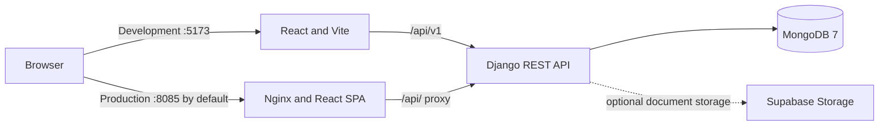

# BizPermit

BizPermit is an industrial compliance and statutory approval portal. It supports business and facility onboarding, permit applications, officer review, document handling, compliance tracking, schemes, grievances, and administrative oversight.

## Architecture



| Component | Development | Production |
|---|---|---|
| Web application | React 18 served by Vite on port `5173` | Static React build served by Nginx on port `8085` by default |
| API | Django 5.1+ and Django REST Framework on port `8000` | Django served by Gunicorn on the private Compose network |
| Application database | MongoDB 7 via PyMongo on port `27017` | MongoDB 7 on the private Compose network |
| Document storage | Optional Supabase Storage integration | Optional Supabase Storage integration |

MongoDB stores the application data in the persistent Docker volume `bizpermit_mongodb_data`. Django's in-memory SQLite configuration is used for framework compatibility; the business repositories use MongoDB. Supabase Storage is optional and is not required to start the core application. The repository also contains a separate self-hosted Supabase Compose stack; it is not started by the standard commands below.

## Prerequisites

- Docker Desktop on Windows or macOS, or Docker Engine on Linux.
- Docker Compose v2 (use a current release for the production Compose override).
- Git, if cloning the repository.

You do not need to install Python, Node.js, or MongoDB on the host to run the containers.

## Install

Clone the repository and enter its directory:

```powershell
git clone https://github.com/ramkumar-lpu/BizPermit_industrial-permit.git
Set-Location BizPermit_industrial-permit
```

Confirm Docker and Compose are available:

```powershell
docker --version
docker compose version
```

The development Compose file has local defaults, so a `.env` file is not required to start the basic application. If you want to customize settings, create a local environment file only if one does not already exist:

```powershell
if (-not (Test-Path .env)) { Copy-Item .env.example .env }
```

On macOS or Linux, the equivalent is:

```bash
test -f .env || cp .env.example .env
```

Edit `.env` before relying on its values. The example contains development defaults and placeholder Supabase values. For local development without cloud storage, leave `SUPABASE_URL` and `SUPABASE_SECRET_KEY` unset or empty. Never commit `.env`; keep production credentials in a deployment secret manager.

## Run the development containers

From the repository root, build the images and start the services in the background:

```powershell
docker compose up --build -d
```

Check container health and status:

```powershell
docker compose ps
```

The development stack starts MongoDB, the Django API, and the Vite frontend. Docker Compose waits for MongoDB and the API health checks before starting dependent services.

| Service | Address |
|---|---|
| BizPermit frontend | <http://localhost:5173> |
| Django API health check | <http://localhost:8000/api/v1/health> |
| MongoDB | `mongodb://localhost:27017` |

The frontend forwards `/api/v1` requests to the backend. Development containers mount the source directories, so code changes are available without rebuilding the images.

### Common container commands

Follow logs:

```powershell
docker compose logs -f
docker compose logs -f backend
```

Run backend tests inside the running backend container:

```powershell
docker compose exec backend python -m pytest
```

The backend suite includes Supabase Storage integration tests. Those cloud-specific tests require valid storage credentials and network access.

Stop the development stack:

```powershell
docker compose down
```

This preserves the MongoDB volume. Do not add `-v` unless you intend to permanently delete the local database data.

## Run the production Compose configuration

Before deploying, create and review `.env`. Replace all development and placeholder values, including:

- `SECRET_KEY` and `JWT_SECRET_KEY` with unique, high-entropy secrets.
- `ALLOWED_HOSTS` and `CORS_ALLOWED_ORIGINS` with the deployment's actual hostnames and HTTPS origins.
- `MONGODB_URI` with an authenticated production database URI where appropriate.
- `SUPABASE_URL` and `SUPABASE_SECRET_KEY` if using cloud-backed document storage.
- `PROD_PORT` if host port `8085` is unavailable.

The production override disables debug mode and demo seeding, disables the mock database fallback, runs the API with Gunicorn, removes source bind mounts, and keeps MongoDB and the backend off published host ports. Terminate HTTPS at a trusted reverse proxy or load balancer and set `HTTPS_ENABLED=True` when configured behind that TLS proxy. Never use the example secrets or development defaults in production.

Validate the merged Compose configuration:

```powershell
docker compose -f docker-compose.yml -f docker-compose.prod.yml config --quiet
```

Build and start production services:

```powershell
docker compose -f docker-compose.yml -f docker-compose.prod.yml up --build -d
```

Check status:

```powershell
docker compose -f docker-compose.yml -f docker-compose.prod.yml ps
```

The portal is available at <http://localhost:8085> by default. `PROD_PORT` changes the host port. The API is available through the Nginx proxy at `/api/v1`; the backend and MongoDB ports are not published to the host in this configuration.

Stop the production stack without deleting persistent data:

```powershell
docker compose -f docker-compose.yml -f docker-compose.prod.yml down
```

## Optional self-hosted Supabase

`docker-compose.supabase.yml` defines a separate self-hosted Supabase stack for PostgreSQL, Auth, REST, Storage, Kong, and an optional Studio profile. It is not part of the standard BizPermit startup. Configure strong, unique values for its required Supabase secrets in `.env` before starting it; do not use the example placeholders.

At minimum, configure `SUPABASE_POSTGRES_PASSWORD`, `SUPABASE_JWT_SECRET`, `SUPABASE_ANON_KEY`, and `SUPABASE_SERVICE_ROLE_KEY`. The anon and service-role keys must be generated for the configured JWT secret. Keep the service-role key server-side.

Start the self-hosted services:

```powershell
docker compose -f docker-compose.supabase.yml up -d
```

To include the local Studio service:

```powershell
docker compose -f docker-compose.supabase.yml --profile dev up -d
```

Kong is bound to `127.0.0.1:8100` and Studio, when enabled, to `127.0.0.1:3001`. Configure the BizPermit storage settings to use this stack before expecting document uploads to use it.
For the backend container, set `SUPABASE_URL=http://supabase-kong:8000` and configure `SUPABASE_SECRET_KEY` (or `SUPABASE_SERVICE_ROLE_KEY`) with the service-role key. The Compose files share the `bizpermit-network` network so the backend can resolve `supabase-kong`.

## Run checks without Docker

For frontend development, install Node.js 20+ and run these commands from `frontend/`:

```powershell
npm ci
npm test
npm run build
```

For backend development, install Python 3.11+ and create a virtual environment. From the repository root, run these commands in Windows PowerShell:

```powershell
Set-Location backend
python -m venv .venv
.\.venv\Scripts\python.exe -m pip install -r requirements.txt
.\.venv\Scripts\python.exe -m pytest
```

On macOS or Linux:

```bash
cd backend
python3 -m venv .venv
. .venv/bin/activate
python -m pip install -r requirements.txt
python -m pytest
```

## Troubleshooting

- Check service health and recent logs with `docker compose ps` and `docker compose logs -f <service>`.
- If a port is already in use, stop the conflicting service or change the corresponding Compose port setting. Production's host port can be changed with `PROD_PORT`.
- The first start builds images and may take several minutes. MongoDB data remains in its named volume after `docker compose down`.
- If document storage is not configured, core application services can still run; cloud-backed uploads require valid Supabase configuration.

## Documentation

- [Docker development and production setup](docs/development/docker.md)
- [Application workflow map](docs/architecture/workflows.md)
- [Deployment and MongoDB operations](docs/operations/deployment.md)
- [Health checks, logging, and monitoring](docs/operations/monitoring.md)
